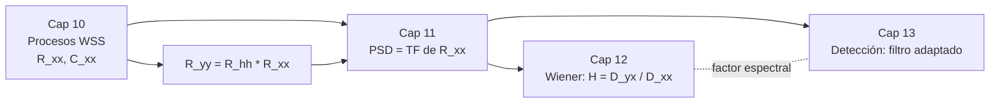

# 📚 Señales Aleatorias, Estimación y Detección

Vault basado en los capítulos 10–13. Cada capítulo es **una sola nota larga**, navegable con el panel de esquema (Outline) de Obsidian.

## Mapa de notas
| Nota | Idea central |
|---|---|
| [[01 Procesos Aleatorios]] | Qué es un proceso aleatorio, momentos, estacionariedad, ergodicidad, paso por sistemas LTI |
| [[02 Densidad Espectral de Potencia]] | PSD/FSD, teorema EWK, periodograma, filtros de modelado y de blanqueo |
| [[03 Estimación de Señales]] | LMMSE, filtro de Wiener (FIR, no causal, causal), observador óptimo / Kalman |
| [[04 Detección de Señales]] | MAP con varias mediciones, filtro adaptado, ruido de color, discriminación de señales |
| [[05 Formulario]] | Todas las fórmulas importantes en un solo lugar |
| [[06 Conexiones entre temas]] | Cómo se encadenan los 4 capítulos y errores típicos |

## Hilo conductor

## Ruta de estudio sugerida
1. [[01 Procesos Aleatorios#Filtrado LTI de procesos WSS]] (es la base de todo lo demás)
2. [[02 Densidad Espectral de Potencia#Filtros de modelado y de blanqueo]]
3. [[03 Estimación de Señales#Filtro de Wiener no restringido]] → [[03 Estimación de Señales#Filtro de Wiener causal]]
4. [[04 Detección de Señales#Filtro adaptado]] y [[04 Detección de Señales#Ruido de color]]

> [!note] Convenciones
> $x[n]$ / $x(t)$ = DT / CT. $R$ = correlación, $C$ = covarianza, $S$ = PSD, $D$ = FSD (densidad espectral de fluctuación). $\mu$ = media. $Q(\cdot)$ = cola de la gaussiana estándar. Las ecuaciones citadas "(10.xx)" son las del texto original.
