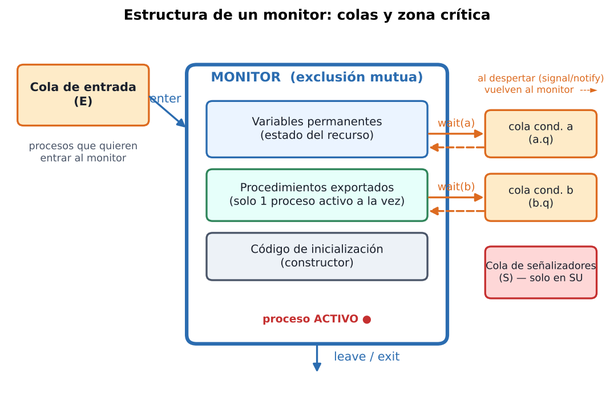
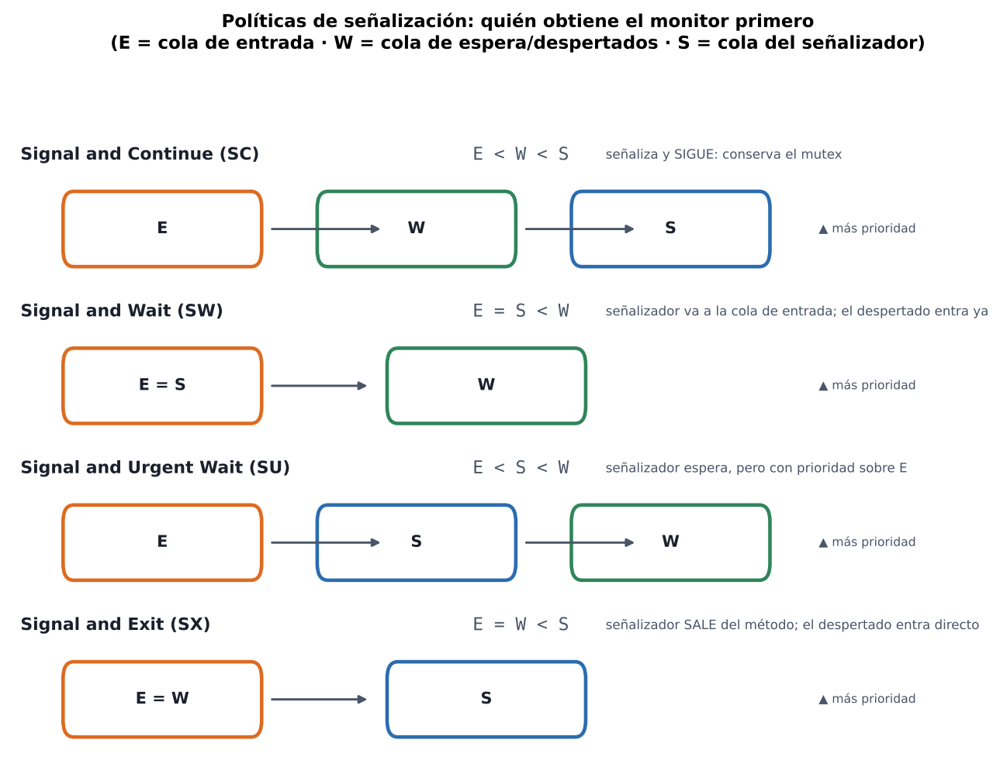
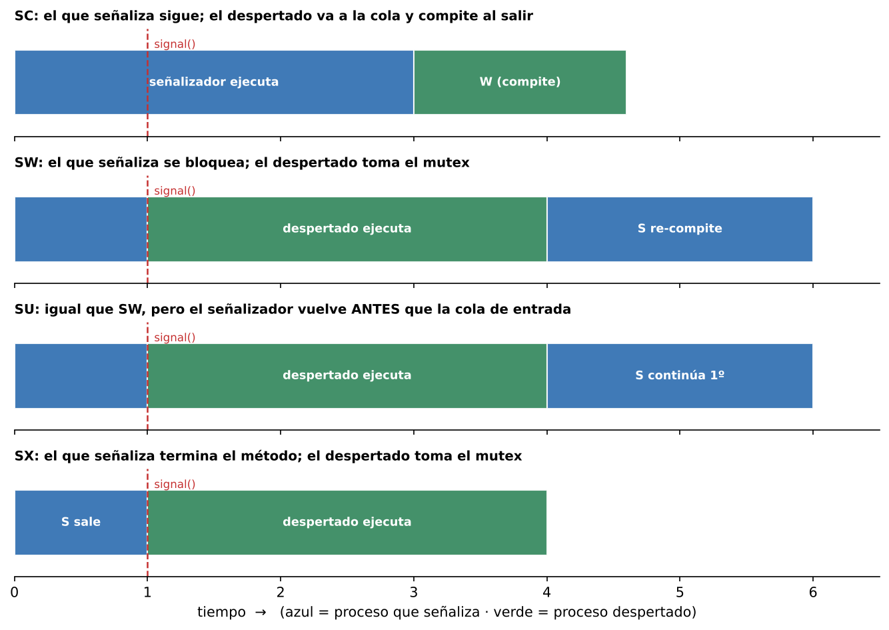

# Monitores — Resumen para estudiar

> Programación Concurrente · Fuente: filminas "Monitores 2020"
> Leyenda: ⚠️ = parte ambigua o inconsistente en las filminas (te marco cómo quedarte con lo seguro).

---

## 1. Idea en una línea

Un **monitor** es un mecanismo de **alto nivel** que **encapsula un recurso compartido** (sus datos + los procedimientos que lo usan) y garantiza **exclusión mutua automática**; la **sincronización por condición** se hace con **variables de condición** (`wait` / `signal`).

Historia: presentado por **Dijkstra (1971)** → **Brinch Hansen (1973)** → refinado por **Hoare (1974)**.

---

## 2. ¿Por qué no alcanzan los semáforos?

| Debilidad del semáforo | Consecuencia |
|---|---|
| Omitir un `wait()`/`signal()` corrompe el sistema | Errores transitorios, difíciles de reproducir |
| El control de concurrencia es responsabilidad del **programador** | Fácil equivocarse |
| Primitivas **esparcidas** por todo el sistema | Código difícil de mantener |
| Sección crítica y sincronización usan **las mismas primitivas** | Difícil distinguir una de otra |
| Cada sección crítica debe empezar con `wait()` y terminar con `signal()` y no se puede restringir qué operaciones se hacen sobre el recurso | Fácil de violar |

**Qué buscamos:** especificar un **recurso compartido** de forma independiente del lenguaje, donde:
- la **comunicación** entre procesos es mediante las **operaciones del recurso**,
- la **exclusión mutua** se da entre **todas** las operaciones del recurso,
- la **sincronización por condición** se define con las **CPRE** (precondiciones) de cada operación.

Formas de implementarlo: métodos `synchronized`, **monitores**, paso de mensajes.

---

## 3. Estructura de un monitor



**Un monitor contiene:**
1. **Variables permanentes** (locales): guardan el **estado interno** del recurso.
2. **Código de inicialización** (constructor).
3. **Procedimientos internos**: manejan las variables permanentes.
4. **Procedimientos exportados**: los únicos que pueden invocar los procesos activos desde afuera.

```text
Monitor nombre_monitor
    var variables_locales;
    export procedimientos_exportados;

    procedure proc1(parametros) { var locales; begin ... end }
    procedure proc2(parametros) { var locales; begin ... end }
begin
    // código de inicialización
end
```

**Analogía de la filmina:** el monitor es una **aduana**: decide si se permite el acceso al recurso o si hay que esperar por un trámite.

Su código tiene **2 partes lógicas**:
- el **algoritmo** de manipulación del recurso y sincronización,
- el **mecanismo** que asigna **en qué orden** los procesos comparten el recurso.

**Reglas que se cumplen siempre**
- Todos los métodos del monitor se ejecutan en **exclusión mutua**.
- Cada método define su **sincronización por condición**: *bloquear* procesos hasta que se cumpla la condición y *notificar* a un proceso bloqueado cuando ya puede seguir.

> Un monitor ≈ **una instancia de una clase que puede usarse de forma segura por múltiples threads**.

---

## 4. Exclusión mutua: cómo la garantiza el monitor

Se basa en la **cola asociada al monitor** (cola de entrada `E`):

1. Un proceso está ejecutando un procedimiento del monitor y otro intenta entrar → el acceso lo **bloquea** y lo manda a la **cola**.
2. Cuando el proceso activo **abandona** el monitor → el monitor toma el **primero de la cola** y lo desbloquea.
3. Si la cola está **vacía** → el monitor queda **libre**.

La exclusión mutua la garantiza **el monitor**, no el programador.

---

## 5. Variables de condición (sincronización por condición)

Una **variable de condición** es un "contenedor" de procesos que **esperan una condición** sobre el estado del monitor. Cada una tiene **su propia cola** (`c.q`).

| Operación | Qué hace |
|---|---|
| `wait(c)` | El proceso invocador **se duerme**, pasa a la cola `c.q` y **libera el monitor** (hace `schedule`) |
| `signal(c)` / `notify(c)` | Si `c.q` está **vacía** → no pasa nada (el que señaliza sigue). Si **no** está vacía → se saca el **primer proceso** de `c.q` y se lo despierta; **qué pasa después depende de la política** |
| `notifyAll(c)` | Mueve **todos** los que esperan en `c.q` a la cola de entrada |

⚠️ *"Despertar" ≠ "ejecutar"*: el proceso despertado **no avanza** hasta obtener el monitor. Quién lo obtiene primero lo define la política (sección 6).

Además, la lógica del monitor **debe dar prioridad a los procesos que esperan** sobre los nuevos que piden entrar; si no, los nuevos le "roban" el recurso y el que espera sufre **postergación indefinida** (starvation).

---

## 6. Políticas de señalización (lo más preguntado)

### 6.1 Notación de colas

Hay tres colas con prioridades relativas:

| Símbolo | Cola |
|---|---|
| **E** (`Ep`) | **Entrada**: procesos que quieren entrar al monitor |
| **W** (`Wp`) | **Espera / condición**: procesos despertados por un `signal` |
| **S** (`Sp`) | **Señalizadores**: procesos que hicieron `signal` y quedaron esperando |

La fórmula (p. ej. `E < W < S`) se lee: **mayor prioridad = a la derecha** (quién obtiene el monitor antes). `=` significa misma prioridad.



### 6.2 Tabla resumen

| Política | Fórmula | ¿Qué pasa con el que señaliza? | ¿Quién ejecuta ahora? |
|---|---|---|---|
| **Signal and Continue (SC)** | `E < W < S` | **Sigue** y conserva el mutex | El que señaliza; el despertado **compite** por el mutex (va a la cola de entrada) |
| **Signal and Wait (SW)** | `E = S < W` | Se **bloquea**, y debe **competir de nuevo** (va a la cola de entrada) | El **despertado** toma el mutex |
| **Signal and Urgent Wait (SU)** | `E < S < W` | Se **bloquea**, pero será el **primero** en recuperar el mutex cuando el despertado lo libere (cola `S`, con prioridad sobre `E`) | El **despertado** |
| **Signal and Exit (SX)** | `E = W < S` | **Sale del método** (`signal and return`) | El **despertado** toma el mutex directo |



> **Para memorizar:** SC = "yo sigo". SW/SU = "te cedo el monitor" (SU: *pero vuelvo yo antes que los de afuera*). SX = "te cedo el monitor y me voy".

⚠️ **Sobre la notación de las filminas:** en SC la fórmula `E < W < S` pone a `S` como "más prioritaria" simplemente porque el que señaliza **no suelta** el monitor; en SX, `S` también aparece como mayor pero el señalizador ya se fue. No intentes "derivar" la política de la fórmula: memorizá la **tabla de arriba** (comportamiento) y usá la fórmula solo como apoyo.

### 6.3 Pseudocódigo de las filminas

**Común a todas**
```text
enter the monitor:
    if the monitor is locked:  add this thread to e;  block this thread
    else:                      lock the monitor

leave the monitor:
    schedule
    return from the method

wait c:
    add this thread to c.q
    schedule
    block this thread
```

**SC (Signal and Continue)** — el notificado va a la cola de entrada
```text
notify c:
    if there is a thread waiting on c.q:
        select and remove one thread t from c.q      (t = "notified thread")
        move t to e                                   # NO toma el monitor aún

notify all c:  move all threads waiting on c.q to e   # con mayor prioridad que los que esperan entrar

schedule:
    if there is a thread on e:  select and remove one from e and restart it
    else:                       unlock the monitor
```

**SU (Signal and Urgent Wait)** — hay cola `s`
```text
signal c:
    if there is a thread waiting on c.q:
        select and remove one thread t from c.q       (t = "signaled thread")
        add this thread to s
        restart t                                     # t ocupa el monitor ahora
        block this thread

schedule:
    if there is a thread on s:        restart one from s   # PRIMERO los señalizadores
    else if there is a thread on e:   restart one from e
    else:                             unlock the monitor
```

**SW (Signal and Wait)** — no hay `s`-cola; el señalizador espera en `e`

**SX (Signal and Exit)**
```text
signal c and return:
    if there is a thread waiting on c.q:
        select and remove one thread t from c.q
        restart t                                      # t ocupa el monitor
    else:
        schedule
    return from the method
```

⚠️ Las filminas muestran el pseudocódigo de SW/SX con la misma figura de colas que SC/SU; lo importante para estudiar es **a qué cola va cada proceso** (tabla 6.2), no el dibujo exacto.

---

## 7. Clasificación de monitores

- **Según la señal**
  - **Señal explícita**: el monitor declara explícitamente variables de señal/condición.
  - **Señal implícita (automática)**: no hay declaración de variables de condición.
- **Según las prioridades** relativas de las **tres colas** (entrada, espera, señalización) → origina las 4 políticas de la sección 6.

---

## 8. Cómo diseñar un monitor (objetivo de la unidad)

El objetivo es resolver problemas de concurrencia que serían muy difíciles con semáforos, **separando**:
- la **lógica** del sistema,
- la **política** del sistema (que emerge de las colas de entrada, condición y cortesía),
- las **acciones** que se ejecutan.

Hay que decidir concretamente:
1. una **estructura general** para los métodos que implementan acciones del recurso compartido,
2. **qué condición** en las colas se requiere para los **bloqueos**,
3. una **estrategia de desbloqueo** cuando hay **varios hilos candidatos**.

---

## 9. Ejemplo de las filminas: Productor–Consumidor (buffer acotado)

Estructura del proyecto: `Buffer.java`, `BufferI.java` (interfaz), `Productor.java`, `Consumidor.java`, `SleepUtilities.java`, `ThreadApp2.java` (main).

- `Productor` y `Consumidor` son `Runnable`; comparten un `Buffer` (recurso compartido).
- `main` crea el buffer, los dos hilos y llama a `start()`.
- La interfaz `BufferI` define `insert(Object)` y `remove()` (bloqueantes o no).

**Buffer (recurso compartido)** usa 3 semáforos para exclusión mutua + condición:

| Semáforo | Valor inicial | Rol |
|---|---|---|
| `mutex` | 1 | Exclusión mutua sobre el buffer |
| `empty` | `BUFFER_SIZE` (3) | Cuenta huecos libres → **bloquea al productor** si está lleno |
| `full` | 0 | Cuenta elementos → **bloquea al consumidor** si está vacío |

```text
insert(item):                      remove():
    empty.acquire()                    full.acquire()
    mutex.acquire()                    mutex.acquire()
    buffer[in] = item; count++         item = buffer[out]; count--
    in = (in+1) % BUFFER_SIZE          out = (out+1) % BUFFER_SIZE
    mutex.release()                    mutex.release()
    full.release()                     empty.release()
```
**Orden importante:** primero el semáforo de **condición** (`empty`/`full`), después el `mutex`; se libera al revés. Si se tomara el `mutex` primero, un productor bloqueado en `empty` tendría el mutex y se produciría **deadlock**.

⚠️ La filmina se titula "Métodos en el monitor" pero el código usa **semáforos** (es la versión con semáforos del mismo problema, modelada con la red de Petri del costado: plazas *Buffer-Huecos*, *Mutex*, *Buffer-Productos*). Tomalo como el ejemplo de partida para luego reescribirlo con un monitor.

---

## 10. Aplicación: monitor que gestiona una Red de Petri (`GestorDeMonitor`)

Es el monitor del trabajo práctico: los hilos piden disparar transiciones y el monitor decide quién avanza. Objetos: `Mutex`, `RdP`, `Colas`, `Políticas`.

Flujo (secuencia de las filminas):
1. El hilo llama a `dispararTransicion()` → `mutex.acquire()` y se pone `k = true`.
2. **Mientras `k`**: `rdp.disparar()` devuelve `k` (¿se pudo disparar?).
3. Si se disparó: se calculan las transiciones **sensibilizadas** `Vs` y las que **tienen hilos esperando** `Vc` (`colas.quienesEstan()`); se hace `m = Vs AND Vc`.
   - Si `m ≠ 0` → `politicas.cual()` elige a quién despertar, `colas.release()` lo despierta y **el hilo actual sale del monitor** (el mutex "se hereda": política tipo *signal and exit*).
   - Si `m = 0` → `k = false`.
4. Si **no** se pudo disparar (`k = false`): se **libera el mutex** y el hilo se **duerme en su cola** (`colas.acquire()`); al despertar continúa.

Cómo dispara `RdP.disparar()` con **tiempo** (diagrama de secuencia de `RdP`): `estaSensibilizado()` → `testVentanaTiempo()`; si está **dentro de la ventana** `[α, β]` dispara; si está **antes** de la ventana, libera el mutex, marca `esperando` y hace `sleep(timestamp + α − ahora)`; luego actualiza el vector de estado `estado = estado + columna` y recalcula sensibilizadas/timestamps.

⚠️ Este flujo está resumido a partir de diagramas UML sin texto explicativo; los nombres de los métodos son los de la filmina, pero si tu TP usa otros, guiate por tu implementación.

---

## 11. Cheat-sheet final

- Monitor = **datos + procedimientos** encapsulados; **un solo proceso activo** dentro.
- **Exclusión mutua**: automática (cola de entrada `E`). **Condición**: `wait`/`signal` sobre variables de condición.
- `wait` → duerme y **libera** el monitor. `signal` → despierta al primero de `c.q`; si no hay nadie, **no hace nada** (no se "guarda", a diferencia del semáforo).
- 4 políticas: **SC** (sigo yo), **SW** (cedo y re-compito), **SU** (cedo y vuelvo primero), **SX** (cedo y salgo).
- Prioridad a los que esperan para evitar **postergación indefinida**.

### Preguntas de repaso
1. ¿Por qué un `signal` sobre una cola vacía se "pierde" en un monitor pero no en un semáforo?
2. En SC, ¿por qué hay que **volver a chequear la condición** al despertar? *(el despertado compite; otro pudo cambiar el estado)*
3. ¿Qué diferencia hay entre SW y SU? *(a quién se le da el monitor cuando el despertado termina)*
4. ¿Qué es la postergación indefinida y cómo la evita la política de prioridades?
5. En el buffer acotado, ¿qué pasa si se invierte el orden `mutex.acquire()` / `empty.acquire()`?
