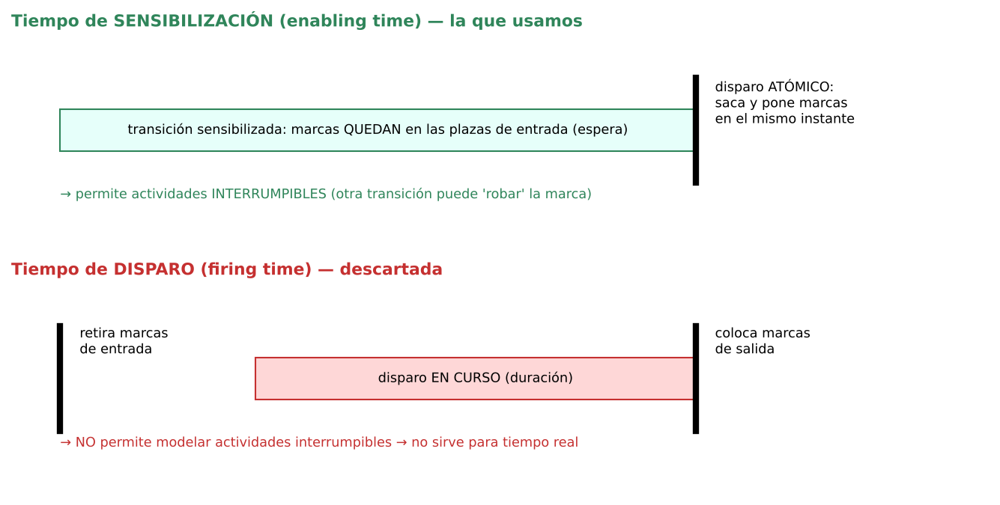
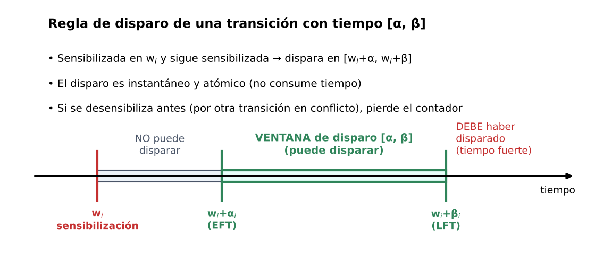
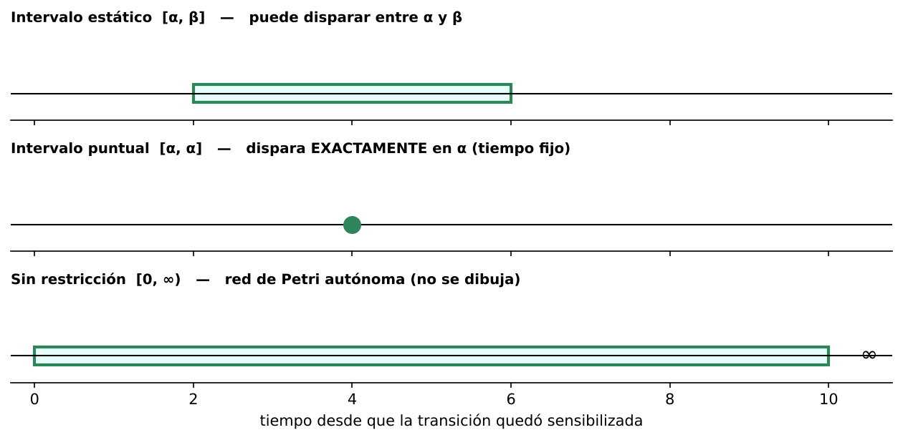
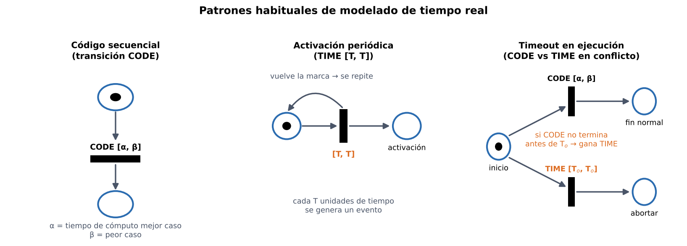
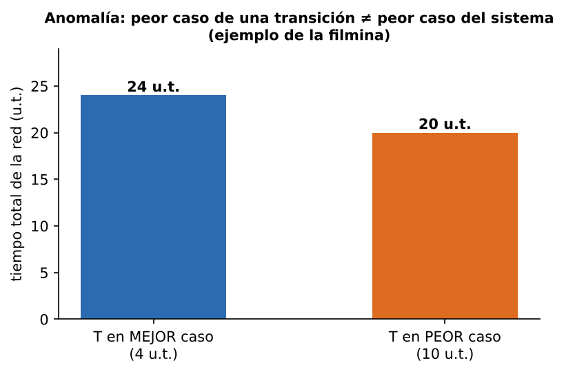
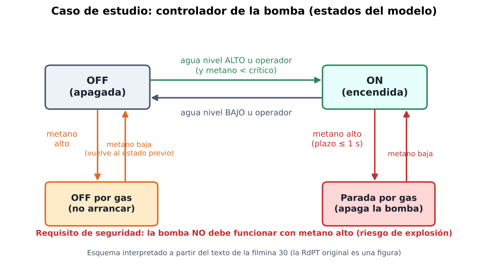
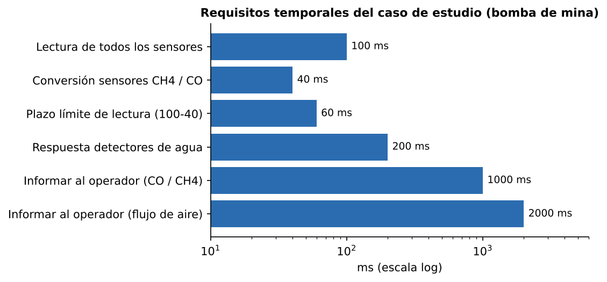
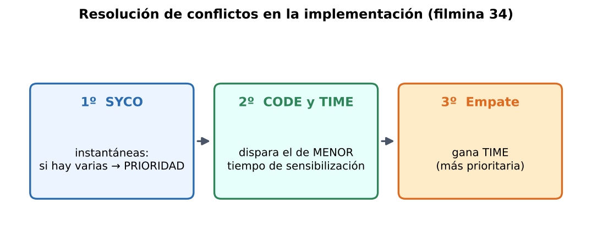

# Redes de Petri Temporales (RdPT) — Resumen para estudiar

> Programación Concurrente / Sistemas de Tiempo Real · Fuente: "Redes de Petri Temporales" (F. J. García Izquierdo)
> ⚠️ = parte ambigua o inconsistente en las filminas (con la forma segura de quedarse).

---

## 1. Idea en una línea

Una **RdPT** es una red de Petri a la que se le agrega a cada **transición un intervalo de tiempo `[α, β]`**: una vez sensibilizada, la transición **no puede disparar antes de α ni después de β**. Sirve para **modelar y verificar sistemas de tiempo real** de forma no ambigua.

---

## 2. ¿Por qué usar redes de Petri en tiempo real?

- Tienen **base matemática** para verificar propiedades:
  - **Vivacidad**: "las cosas pasan".
  - **Corrección**: "las cosas pasan de manera adecuada".
- Permiten **validar requisitos funcionales y temporales** en **etapas tempranas** (detección temprana de errores).
- Hay que tener en cuenta la **asignación de prioridades** de la etapa de planificación.
- Permiten agregar al modelo **elementos redundantes** para **comprobar en ejecución** el comportamiento → ayuda en **mantenimiento y prueba**.

---

## 3. De la red de Petri "pura" a las interpretadas

- Un modelo autónomo = **estructura de red + marcado**. El formalismo, por sí solo, **no da significado** a los objetos.
- La **interpretación** conecta el formalismo con la realidad. Las RdP autónomas son **semi-interpretadas**:
  - **lugares** = variables de estado,
  - **transiciones** = transformadores de estado,
  - la regla de **sensibilización/disparo** = reglas del comportamiento dinámico.
- Al agregar restricciones por interpretación (tiempos, políticas de conflicto) el comportamiento se **restringe** (se reduce el indeterminismo).

### Indeterminismo y cómo se reduce

Indeterminismo de la red pura: **no dice cuándo** dispara una transición sensibilizada (ni si dispara), **ni cuál** dispara entre las que están en conflicto.

| Extensión | Cómo reduce el indeterminismo | ¿Sirve en tiempo real? |
|---|---|---|
| **Estocásticas** (SPN) | Estimación estocástica del instante de disparo | ❌ No admisible en RT |
| **Temporizadas** (Timed PN) | Un tiempo asociado | ✔ |
| **Fuzzy-timing** | Acotan los instantes en que puede/debe dispararse | ✔ |
| **RdP con prioridad** | Número entero positivo `π(t)` por transición: ante conflicto **dispara la de mayor prioridad** entre las sensibilizadas | ✔ (complemento) |

**Grado de sensibilización `E(t)`**: cuántas veces puede dispararse **concurrentemente** una transición (**servidor sencillo** vs **múltiple**).

---

## 4. Semántica del tiempo (¡pregunta típica!)

| | Tiempo de **sensibilización** (*enabling time*) | Tiempo de **disparo** (*firing time*) |
|---|---|---|
| Qué mide el parámetro | Tiempo desde que la transición queda sensibilizada hasta que dispara | Tiempo entre retirar marcas de entrada y poner marcas de salida |
| ¿El disparo es atómico? | **Sí** (retira y coloca a la vez) | **No** (3 fases: retirar → en curso → colocar) |
| Actividades **interrumpibles** | ✔ Se pueden modelar | ❌ No se pueden |
| ¿Se usa en la materia? | ✔ **Sí, es la elegida** | ❌ Descartada para RT |

La de tiempo de disparo es un **caso particular** simulable con: *disparo inmediato de comienzo* + *actividad en curso* + *disparo inmediato de fin*.

### Delay vs. intervalo
- **RdP con delay**: el tiempo asociado representa la **duración** de la actividad (cada transición modela el *final* de una actividad).
- **RdP con tiempo (intervalos)**: se asocia un **intervalo** que abarca todas las duraciones posibles → permite **análisis del peor caso** y cotas de tiempo de ejecución.

### Tiempo fuerte vs. débil
- **Fuerte** (*strong*): hay que indicar **cuándo y bajo qué condiciones** debe dispararse (**obligada a disparar a más tardar en β**). ✔ **Apropiada para RT**.
- **Débil** (*weak*): no está obligada a disparar, pero **si lo hace debe ser dentro del intervalo**. Se puede modelar con la fuerte agregando una **transición en conflicto que aborte** (y es más claro).

---

## 5. Definición formal de una RdPT

**N = { P, T, Pre, Post, M₀, CIS }**

| Símbolo | Significado |
|---|---|
| `P` | Conjunto finito y no vacío de **lugares** |
| `T` | Conjunto finito y no vacío de **transiciones** (`P ∩ T = ∅`) |
| `Pre : P×T → ℕ` | Función de **incidencia previa** (arcos de entrada) |
| `Post : P×T → ℕ` | Función de **incidencia posterior** (arcos de salida) |
| `M₀ : P → ℕ` | **Marcado inicial** |
| `CIS : T → Q⁺ × (Q⁺ ∪ {∞})` | A cada transición `tᵢ` le asigna un **intervalo estático** `(αᵢ, βᵢ)` |

Condiciones del intervalo: `0 ≤ αᵢ < ∞`, `0 ≤ βᵢ ≤ ∞`, y `αᵢ ≤ βᵢ` si `βᵢ ≠ ∞` (o `αᵢ < βᵢ` si `βᵢ = ∞`).

### Regla de disparo

- `tᵢ` queda **sensibilizada en el instante wᵢ** y **sigue sensibilizada**.
- Puede dispararse **no antes de `wᵢ + αᵢ`** y **no más tarde de `wᵢ + βᵢ`** → intervalo de disparo válido **`[wᵢ+αᵢ, wᵢ+βᵢ]`**.
- Las marcas **permanecen en las plazas de entrada** mientras espera; al disparar, el disparo es **instantáneo** (no consume tiempo).
- `αᵢ` = **EFT** (*earliest firing time*, instante más cercano) · `βᵢ` = **LFT** (*latest firing time*, instante más lejano).

⚠️ La filmina dice que "la semántica del disparo es de tiempo **débil**" en la regla general, pero en otra filmina se elige la semántica **fuerte** para RT. **Quedate con:** la regla usa intervalos con **semántica de tiempo de sensibilización**, y para tiempo real se interpreta **fuerte** (debe disparar a más tardar en β).

### Casos particulares del intervalo

| Intervalo | Significado |
|---|---|
| **Estático** `[αᵢ, βᵢ]` | Ventana general de disparo |
| **Puntual** `[αᵢ, αᵢ]` | Transición con tiempo de sensibilización **fijo** |
| **Sin restricción** `[0, ∞)` | Es el formalismo **autónomo** de Petri (por convención no se dibuja) |

### Estado de una RdPT
Para decidir qué puede dispararse hay que conocer **(a)** la sensibilización y **(b)** el tiempo transcurrido desde que se sensibilizó:

**`S = (M, I)`** donde `M` es el **marcado** e `I` el **vector de intervalos de disparo** de todas las transiciones sensibilizadas por `M`.

---

## 6. Subclases y formalismo elegido

- **TER** (*Time Environment/Relationship nets*): redes de alto nivel tipo CPN; las marcas llevan un **timestamp** (`chronos`). Más general: incluye a las RdPT como caso particular. El `chronos` de las marcas producidas es **idéntico** y **no inferior** al mayor de las marcas de entrada.
- **TB** (*Time Basic nets*): caso de TER donde el único dato de la marca es `chronos`.
- ✅ **Formalismo usado en la materia: RdP con Tiempo (RdPT)**: simple, adecuado para RT, y otros formalismos temporales se pueden modelar con él. **No alcanza** para sistemas que requieren CPN (colores).
- Extensión: a veces se asocian **predicados** a las transiciones que condicionan el disparo; dependen de **datos del sistema no representados explícitamente** en la red.

---

## 7. Modelado de sistemas de tiempo real

Debe representarse **sin ambigüedad**:
- **Eventos** (internos y externos) a los que responde el sistema,
- **patrones temporales** de esos eventos (periodicidad / aperiodicidad),
- **acciones** que disparan y sus tiempos (mejor y peor caso de cómputo),
- **interacciones** entre acciones: sincronización, comunicación, precedencia.

### Los 3 tipos de transiciones (¡memorizar!)

| Tipo | Qué representa | Intervalo | Prioridad se relaciona con… |
|---|---|---|---|
| **CODE** | Ejecución de un **código/actividad** (parte operativa) | `[α, β]` = **mejor y peor** tiempo de ejecución | La **planificación** del sistema |
| **TIME** | Actividad **temporal**: *timeout*, activación periódica… Al dispararse provoca acciones de control | `[α, β]` = intervalo en que dispara tras sensibilizarse | Control y **supervisión temporal** (resuelve conflictos) |
| **SYCO** | **Sincronización/control**: sin significado temporal | `[0, 0]` implícito → **disparo inmediato** | Control y supervisión (sincronizaciones, cambios de estado, eventos no temporales, excepciones) |

### Eventos de activación
- **Del entorno** (externos, p. ej. interrupciones — se modela la parte que debe *responder* el sistema).
- **Internos**: un cambio de estado dentro del sistema.
- **Temporales**: transcurre una cantidad de tiempo. Según el **patrón de llegada**: **periódico** (período T), **irregular acotado** (separación mínima entre dos ocurrencias), **en ráfaga** y **no acotado**.

### Situaciones habituales

| Situación | Idea |
|---|---|
| **Código secuencial** | Transición `CODE [α, β]` (mejor/peor caso) |
| **Activación periódica** | `TIME [T, T]` que reinyecta la marca |
| **Activación aperiódica** | Evento del entorno con intervalo `[S, ∞]` (según la figura de la filmina) |
| **Timeout en ejecución** | `CODE` en conflicto con `TIME [Tₒ, Tₒ]`: si el código no termina antes del instante, se **abandona** |
| **Timeout en comunicación** | Evita una espera infinita al comunicarse |
| **Transferencia asíncrona de control** | Permite **abandonar** la actividad si ocurre cierto evento |

> Los timeouts, la suspensión/aborto y la transferencia asíncrona **solo se pueden modelar con semántica de tiempo de sensibilización** (no con tiempo de disparo).

### Anomalía del peor caso

**Ejecutar cada elemento en su peor caso NO equivale al peor caso del sistema completo.** Ejemplo de la filmina: si el tiempo de la transición T es el de **peor caso (10 u.t.)** la red tarda **20 u.t.**; con el de **mejor caso (4 u.t.)** tarda **24 u.t.** → hay que **analizar** y no asumir.

⚠️ La filmina muestra el resultado pero la figura de la red no está en el texto; quedate con la **conclusión** (no basta sumar peores casos).

### Restricciones del modelo (resumen de la filmina)
- **Peso de los arcos**: unitario o entero.
- **Arco inhibidor**: sí o no · **Plaza limitada**: sí o no.
- Que las transiciones puedan **dispararse al menos una vez** (permite que todas las partes del sistema sean ejecutables y modelar inicio/finalización con una plaza iniciada en 1).
- **Grado de sensibilización**: **1** = sistemas secuenciales sin código reentrante; **2** = sistema paralelo con código reentrante; **más de 2**…
- Transiciones **con o sin lugares de entrada** (las que no tienen pueden introducir marcas al sistema).
- Un lugar puede tener **una** transición `CODE` de salida (el sistema no ejecuta a la vez dos códigos distintos), **más de una** `TIME` con `[α, α]` y `α > 0`, y **más de una** `SYCO [0,0]`.

⚠️ Esta filmina está en formato de imagen y es densa; si te la toman, pedí la versión original. Lo central: **1 CODE de salida por lugar, TIME con α>0, SYCO con [0,0]**.

---

## 8. Ejemplo de modelado (filmina 24)

Fragmento de un sistema de RT:
- **Proceso periódico** de período **T = 100 u.t.** (caja **A**: activación periódica).
- Adquiere un recurso, ejecuta **CODE** (caja **B**) con **timeout T.O.1 = 75 u.t.**; luego libera el recurso.
- Luego hay **comunicación síncrona** con otro proceso en *entry A*, con **timeout T.O.2 = 5 u.t.** (caja **C**).

---

## 9. Caso de estudio: bomba de una mina

Sistema que **bombea a la superficie el agua del sumidero** de un pozo. **Requisito de seguridad principal:** la bomba **no debe funcionar con nivel alto de metano** (riesgo de explosión).

### Requerimientos funcionales (4 componentes)
1. **Accionamiento de la bomba**: si el agua llega al **nivel superior** (o lo indica el operador) → **enciende** (solo si metano < crítico); si llega al **nivel inferior** (o lo indica el operador) → **apaga**.
2. **Monitorización del entorno**: mide metano, **monóxido de carbono** y **flujo de aire**; valores críticos → **alarma**.
3. **Interacción con el operador**: consola en superficie; informa los eventos críticos.
4. **Monitorización del sistema**: todos los eventos se **guardan** para visualizarlos luego.

### Requerimientos no funcionales (foco: **tiempo**; también confiabilidad y seguridad)

- **Período de monitorización**: sensores leídos cada **100 ms**; conversión CH₄/CO de **40 ms** → plazo límite de **60 ms**.
- **Sensor de flujo de agua**: al apagar la bomba hay que esperar **1 s** a que el agua deje de fluir; el estado real se determina con **dos lecturas consecutivas** (a los **960 ms** y **1040 ms** tras apagar).
- **Detectores de agua**: dirigidos por eventos; el sistema debe responder en **200 ms**; debe haber **≥ 6 s** entre interrupciones de los niveles de agua.
- **Plazo de información al operador**: **cada 1 s** para lecturas sobre el límite de **CO / metano**; **cada 2 s** para flujo de aire por debajo del valor crítico.
- **Tiempo límite de parada** (evitar explosiones): relación **`R·(T + D) < M`**, con
  `R` = tasa de acumulación del metano · `T` = período de muestreo · `D` = tiempo límite de parada · `M` = margen de seguridad.
  Si se usa **desplazamiento de período**, la condición pasa a **`R·(2T + D) < M`**.

### Modelos de RdPT del caso
- **Controlador de la bomba**: estados **ON / OFF**, **no arrancar por gas** (deshabilitada con metano alto; vuelve al estado anterior cuando baja) y **parada por gas**.
- **Lectura de sensores**: muestreo de **metano** y **CO**; **plazo de apagado de 1 s** ante metano sobre el umbral; **plazo de 1 s** para informar al operador; el acceso al dispositivo está protegido con un **timeout** (si no responde, se suspende la lectura y se informa al operador); un **predicado** indica el nivel de agua.

⚠️ **Inconsistencias en las filminas (verificar con el docente):**
- Filmina 31 menciona "60 segundos para el sensor de CO / 5 segundos para metano" mientras la 27 fija lecturas cada **100 ms** y conversión de **40 ms**. Probablemente son los períodos de *ese* modelo concreto; para el examen usá los valores de la filmina 27 si la pregunta es sobre requisitos.
- El "tiempo límite de parada" aparece como **1 s** (filmina 31) y con un valor conservador de **200 ms** en el texto de requisitos. Lo importante es la **inecuación `R(T+D) < M`**.
- El esquema de la figura de arriba es **interpretado** del texto (la RdPT original es una figura).

---

## 10. Planificación y análisis

### Planificación (del modelo a la plataforma)
- El modelo teórico de las RdP supone **recursos infinitos**: todo lo ejecutable corre **en paralelo**.
- La implementación real tiene **restricciones**: *hardware* (procesadores, memoria finitos), *software* (SO/scheduling, primitivas del lenguaje) y **prioridades** de los procesos (hay que garantizar con una buena asignación que se cumplan los requisitos de RT).
- **No se conocen trabajos de TPN con prioridades dinámicas.**

### Análisis: ¿se cumplen todos los requisitos temporales?
- Se basan en técnicas **enumerativas** (**grafo de alcanzabilidad**).
- Con tiempo el número de estados alcanzables (estado + instante) es **muy grande, incluso infinito** (tiempo continuo).
- Soluciones: **discretización temporal** o **grafo de clases de estados** (**State Class Graph**).

---

## 11. Implementación (cómo se ejecuta una RdPT en software)

El software debe **simular el disparo de transiciones** y **respetar las reglas de evolución del marcado**:
1. establecer la regla de **sensibilización**,
2. **disparar** las transiciones sensibilizadas,
3. **actualizar el marcado**.

**Simplificaciones adoptadas:** servidor único · disparo **inmediato** de SYCO · comienzo inmediato del código de las CODE · semántica de **tiempo de sensibilización** · política de resolución de conflictos:

1. Primero **SYCO** (instantáneas): si hay varias → por **prioridad**.
2. Luego **CODE y TIME**: dispara **el que termina antes** (menor tiempo de sensibilización).
3. **Empate** → **TIME** es más prioritaria.

**Secuencial vs. concurrente:** la concurrencia en el disparo puede interpretarse como **entrelazado** (*interleaving*). En una implementación **secuencial** el **orden** de disparo de transiciones concurrentes **importa** para el comportamiento del modelo.

(Para cómo lo implementa el monitor `GestorDeMonitor` / `RdP.disparar()` con ventana de tiempo, ver el resumen de **Monitores**, sección 10.)

---

## 12. Cheat-sheet final

- **RdPT = RdP + intervalo `[α, β]` por transición.** Disparo en `[wᵢ+α, wᵢ+β]`, **instantáneo**.
- **Semántica elegida:** tiempo de **sensibilización**, **fuerte** (para RT). Permite interrupciones/timeouts.
- **Tipos:** **CODE** (código, mejor/peor caso) · **TIME** (timeouts, periodicidad) · **SYCO** (sincronización, `[0,0]`).
- **Estado:** `S = (M, I)`.
- **Análisis:** grafo de alcanzabilidad → **clases de estados** (State Class Graph).
- **Cuidado:** peor caso por transición ≠ peor caso del sistema.
- **Conflictos en implementación:** SYCO por prioridad → CODE/TIME por menor tiempo → empate gana TIME.

### Preguntas de repaso
1. ¿Por qué no sirven las redes estocásticas en tiempo real?
2. ¿Por qué se elige la semántica de **tiempo de sensibilización** y no la de **tiempo de disparo**?
3. Dada una transición con `[2, 6]` sensibilizada en `t = 10`, ¿cuándo puede y cuándo debe dispararse? *(puede desde 12; debe a más tardar en 16)*
4. Diferencia entre transiciones **CODE**, **TIME** y **SYCO**.
5. ¿Qué es un **timeout en ejecución** y cómo se modela? *(CODE en conflicto con TIME)*
6. ¿Por qué el análisis del grafo de estados es complicado con tiempo y cómo se soluciona?
