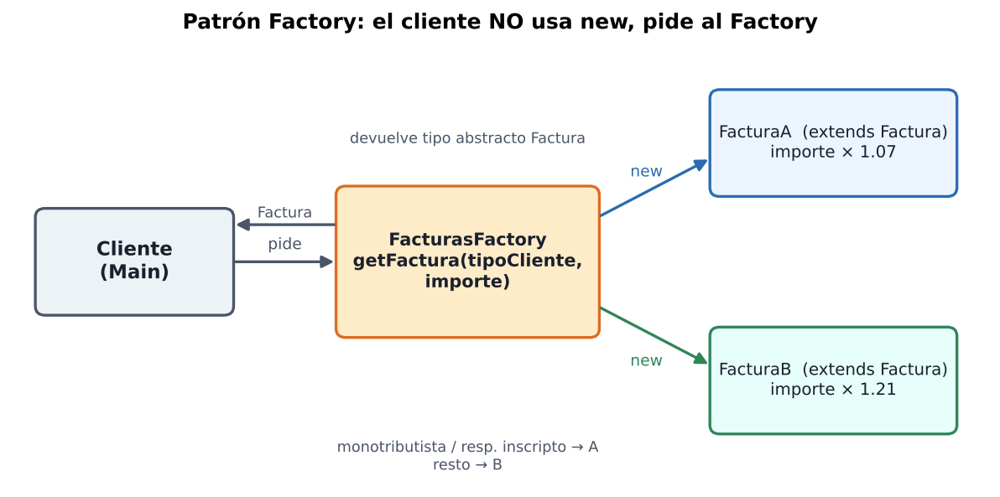
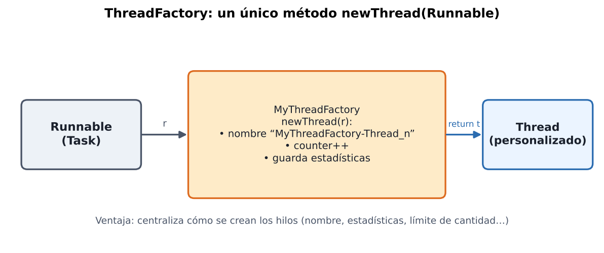
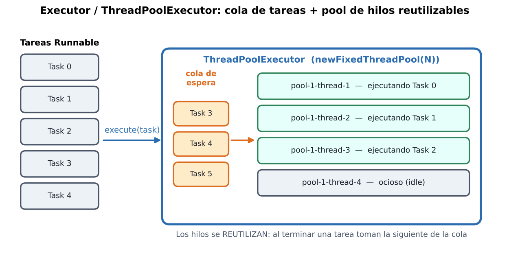
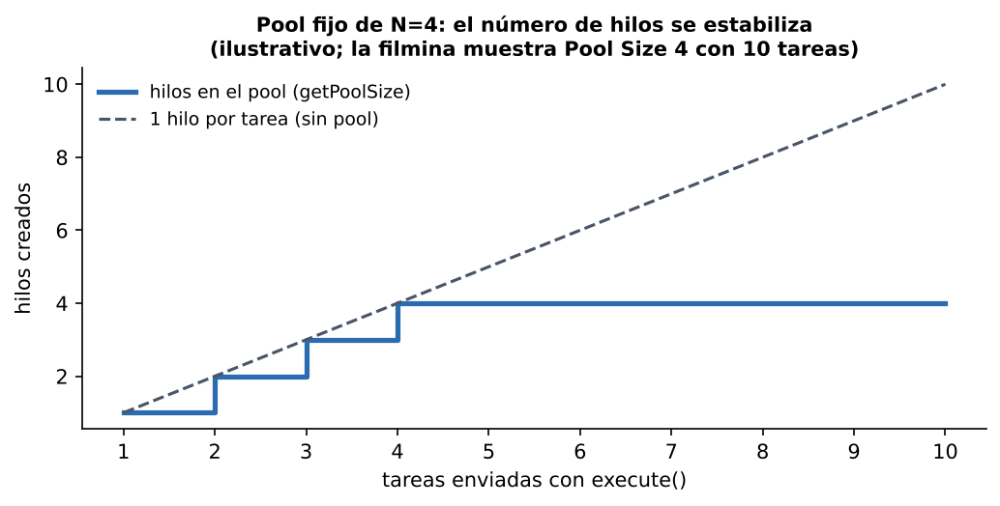
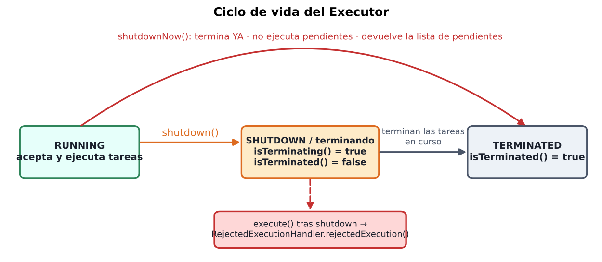

# Thread Factory y Executors — Resumen para estudiar

> Programación Concurrente 2024 · Fuente: "Filminas Clase 8" (Ing. Ventre / Ing. Ludemann)
> ⚠️ = parte ambigua o inconsistente en las filminas. Lo marcado como **(extra)** NO está en las filminas; lo agrego solo para conectar ideas.

---

## 1. Visión general

| Tema | Problema que resuelve | Herramienta de Java |
|---|---|---|
| **Factory** | Crear objetos sin usar `new` directamente, de forma centralizada | Patrón creacional |
| **ThreadFactory** | Crear **hilos** de forma centralizada y personalizada (nombre, estadísticas, límites) | Interfaz `ThreadFactory` |
| **Executor** | Evitar "un hilo por tarea" (costoso); **reutilizar** hilos | `Executors` / `ThreadPoolExecutor` |

---

## 2. Patrón Factory



- Es **creacional**: provee una interfaz para crear una **familia de objetos sin especificar la clase concreta**. Abstrae al usuario de los tipos concretos.
- Para crear una nueva instancia se usa el **Factory** en lugar de `new()`.

### Ventajas (porque **centraliza** la creación)
- Es fácil **cambiar la clase** de los objetos creados y **la manera** en que se crean.
- Es fácil **limitar** la creación (p. ej. solo **n** objetos de una clase).
- Es fácil recolectar **estadísticas** sobre la creación.

### Ejemplo de las filminas: facturas
- `Factura` (**abstracta**): `id`, `importe`, `getImporteIva()` abstracto.
- `FacturaA extends Factura` → `importe * 1.07` · `FacturaB extends Factura` → `importe * 1.21`.
- `FacturasFactory.getFactura(tipoCliente, importe)`: si el cliente es **monotributista** o **responsable inscripto** → `FacturaA`; si no → `FacturaB`. Además lleva un **contador** (`facturasContador++`) para asignar los `id`.
- En `Main`: `factory.getFactura("monotributista", 1000)` → IVA **1070.00**; `getFactura("comun", 1000)` → **1210.00**.

```java
public Factura getFactura(String tipoCliente, double importe) {
    Factura f;
    if (tipoCliente.equals("monotributista") || tipoCliente.equals("responsable inscripto"))
        f = new FacturaA(facturasContador, importe);
    else
        f = new FacturaB(facturasContador, importe);
    facturasContador++;
    return f;
}
```

### Responsabilidades de la clase Factory
- **Conocer** los tipos que existen.
- **Instanciar** el correcto según el caso (cliente).
- **Llevar la cuenta** y asignar identificadores.
- **Abstraer** a los demás: usan solo `Factura`; el Factory se encarga de la concreta.
- **Centralizar, encapsular y simplificar** la creación.

---

## 3. ThreadFactory



- Java trae una interfaz para aplicar este patrón a **hilos**: **`ThreadFactory`**.
- Tiene **un solo método**: **`newThread(Runnable r)`** → recibe un `Runnable` y **devuelve un `Thread`**.
- Muchas implementaciones son una línea: `return new Thread(r);`
- Pero dan **flexibilidad** para: **crear hilos personalizados**, **guardar estadísticas**, **validar la cantidad** de hilos creados, etc.

### Ejemplo (Ejercicio 10, cap. 1 del libro): `MyThreadFactory`

```java
public class MyThreadFactory implements ThreadFactory {
    private int counter;            // cuántos hilos creó
    private String name;            // prefijo del nombre
    private List<String> stats;     // estadísticas

    public MyThreadFactory(String name) { counter = 0; this.name = name; stats = new ArrayList<>(); }

    @Override
    public Thread newThread(Runnable r) {
        Thread t = new Thread(r, name + "-Thread_" + counter);   // nombre personalizado
        counter++;
        stats.add(String.format("Created thread %d with name %s on %s\n",
                                t.getId(), t.getName(), new Date()));
        return t;
    }
    public List<String> getStats() { return stats; }
}
```

- `Task implements Runnable`: hace `TimeUnit.SECONDS.sleep(1)` en su `run()`.
- `Main`: crea la factory, **un** `Task` y, en un `for` de 10 iteraciones, `thread = factory.newThread(task); thread.start();`. Al final imprime `factory.getStats()`.
- **Salida:** 10 hilos de nombre `MyThreadFactory-Thread_0 … _9` (ids 10 a 19 en esa corrida).

> 💡 **Idea clave de la filmina:** al usar un Factory hay que **asegurarse de que TODOS los hilos del programa se creen de esa misma manera** (si algún hilo se crea con `new Thread` por afuera, se pierden nombres y estadísticas).

---

## 4. Executors

### 4.1 Problema y solución

**Sin Executors**, en una app concurrente uno debe implementar:
- todo el código de **creación y manejo** de hilos,
- **un hilo por tarea** → con **muchas tareas** esto **afecta el rendimiento**.

**Solución de Java:** el **Framework de Executors** (clase **`ThreadPoolExecutor`**).
- Uno solo se ocupa de crear los objetos **`Runnable`** y **enviarlos** al `ThreadPoolExecutor`.
- El executor es responsable de **ejecutar, instanciar y usar** los hilos necesarios, y mejora el rendimiento con un **pool de hilos**.
- Al enviar una tarea, **intenta ejecutarla con un hilo ocioso** del pool.



### 4.2 Cómo se usa (pasos)
1. Crear un `ThreadPoolExecutor` (hay varios métodos para crear distintos **tipos** de executors).
2. Enviarle **tareas `Runnable`** con **`execute()`**.
3. (Opcional) asignarle un **handler** para cuando **no puede ejecutar** una tarea.
4. **Finalizarlo** (`shutdown`).

En el ejemplo se usa **`Executors.newFixedThreadPool(n)`**: crea y **reutiliza como máximo `n` hilos**; la ventaja de reutilizar es **ahorrar el tiempo de creación** de hilos.

```java
executor = (ThreadPoolExecutor) Executors.newFixedThreadPool(
               Runtime.getRuntime().availableProcessors());   // n = cantidad de núcleos
executor.setRejectedExecutionHandler(new RejectedTaskController());
executor.execute(task);
```



### 4.3 Métodos de monitoreo

| Método | Devuelve |
|---|---|
| `getPoolSize()` | Cantidad **actual de hilos** en el pool |
| `getActiveCount()` | Cantidad de hilos **ejecutando** efectivamente |
| `getTaskCount()` | Cantidad de tareas que **alguna vez fueron programadas** |
| `getCompletedTaskCount()` | Cantidad de tareas **finalizadas** |

⚠️ La filmina escribe `getCompleteTaskAccount()` y `excecute()` (errores de tipeo). Los nombres reales son **`getCompletedTaskCount()`** y **`execute()`** (el código de la filmina usa los correctos).

### 4.4 Finalizar el executor (¡importante!)
Si no se finaliza, el executor **sigue esperando nuevas tareas** (el programa no termina).

| Método | Comportamiento |
|---|---|
| **`shutdown()`** | **No acepta nuevas tareas**; **termina las que está ejecutando** (y las ya encoladas) y luego se cierra |
| **`shutdownNow()`** | Finaliza **de inmediato**; **no ejecuta las pendientes** y **devuelve la lista de tareas pendientes**. Las que estaban en ejecución se interrumpen/finalizan |



### 4.5 Tareas rechazadas: `RejectedExecutionHandler`

- Si se envía una tarea a un executor **ya apagado**, se activa el **handler** asignado → se ejecuta su método **`rejectedExecution(Runnable r, ThreadPoolExecutor executor)`**.
- En el ejemplo, `RejectedTaskController implements RejectedExecutionHandler` imprime que la tarea fue rechazada y el estado del executor (`isTerminating()`, `isTerminated()`).

### 4.6 Ejemplo completo (Ejercicio 1, cap. 4)

Clases: `Main`, `Server`, `Task`, `RejectedTaskController`.

- **`Server`**: encapsula el `ThreadPoolExecutor`; `executeTask(task)` hace `execute()` e imprime *Pool Size / Active Count / Task Count / Completed Tasks*; `endServer()` llama a `shutdown()`.
- **`Task implements Runnable`**: guarda fecha de creación y nombre; en `run()` imprime "Created/Started", **duerme un tiempo aleatorio (0–10 s)** y imprime "Finished".
- **`Main`**: crea el server, envía tareas, hace `server.endServer()` y **después intenta enviar otra tarea** → **es rechazada**.

**Qué se ve en la salida (para interpretarla):**
1. El **Pool Size crece 1, 2, 3, 4…** a medida que llegan tareas, hasta el máximo del pool; luego se **estabiliza** y las tareas **esperan en cola** (por eso *Task Count* sube pero *Active Count* no pasa del tamaño del pool).
2. Tras `shutdown()`: *"Main: Shutting down the Executor"*.
3. La tarea enviada después → **`RejectedTaskController`**: `Terminating: true`, `Terminated: false` (**está terminando pero aún quedan tareas corriendo**).
4. `Main: End.` se imprime **antes** de que terminen las tareas: el `main` **no espera** al executor; las tareas en curso siguen y terminan después (**`shutdown()` no bloquea**).

⚠️ **Inconsistencia en la filmina:** el código de `Main` envía **100** tareas (`i<100`), pero la captura de salida muestra **Task Count: 10**. Probablemente la captura es de una corrida con 10 tareas. No cambia la idea: el pool **limita** hilos y **encola** el resto.

---

## 5. Cómo se conectan los dos temas **(extra, no está en las filminas)**

Los executors usan internamente una `ThreadFactory` para crear sus hilos (por eso en la salida aparecen nombres como `pool-1-thread-1`). Se puede pasar la propia: `Executors.newFixedThreadPool(n, new MyThreadFactory("Pool"))` → los hilos del pool llevarían nombre personalizado y estadísticas.

Otros tipos de pool habituales: `newCachedThreadPool()`, `newSingleThreadExecutor()`; y para tareas con **resultado** se usa `submit()` con `Callable` → `Future` (no cubierto en estas filminas).

---

## 6. Cheat-sheet final

- **Factory** = no uses `new`, pedíselo a una clase que **centraliza** la creación.
- **`ThreadFactory.newThread(Runnable)`** → `Thread` personalizado (nombre, stats, límites).
- **Executor** = pool de hilos **reutilizables** + cola de tareas; vos solo enviás `Runnable`s con **`execute()`**.
- **`newFixedThreadPool(n)`**: máximo **n** hilos (típicamente `availableProcessors()`).
- **Siempre finalizar:** `shutdown()` (espera y no acepta nuevas) vs `shutdownNow()` (ya mismo, devuelve pendientes).
- Tarea enviada a executor apagado → **`RejectedExecutionHandler.rejectedExecution()`**.
- Monitoreo: `getPoolSize`, `getActiveCount`, `getTaskCount`, `getCompletedTaskCount`.

### Preguntas de repaso
1. ¿Qué ventajas da un Factory frente a `new`? Nombrá 3.
2. ¿Cuántos métodos tiene `ThreadFactory` y qué recibe/devuelve?
3. ¿Por qué un pool mejora el rendimiento frente a "un hilo por tarea"?
4. Diferencia entre `shutdown()` y `shutdownNow()`.
5. ¿Qué pasa si se llama a `execute()` luego de `shutdown()`? ¿Quién lo maneja?
6. En la salida del ejemplo, ¿por qué `Terminating: true` pero `Terminated: false`?
